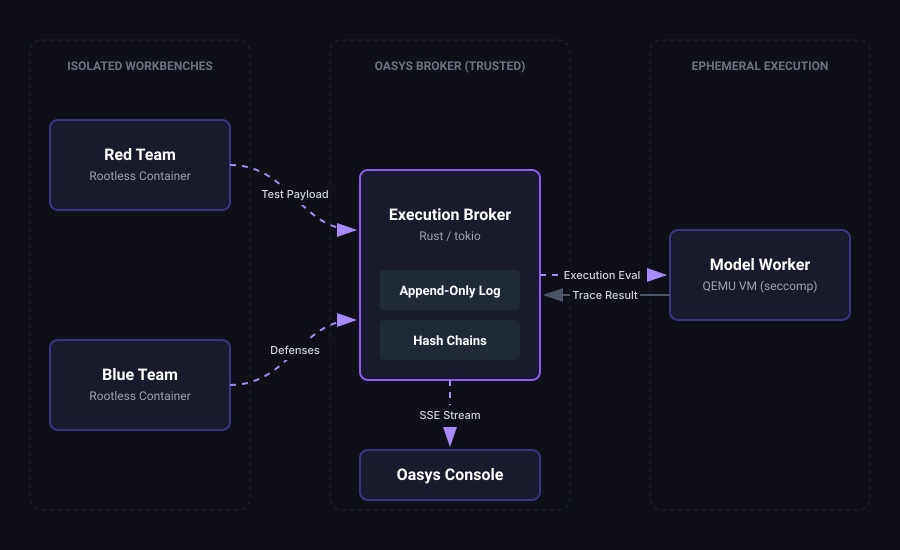

<a id="readme-top"></a>

<div align="center">
  
  <br />
  <h1 align="center">Oasys</h1>
  <p align="center">
    Trustworthy Adversarial AI Testing Infrastructure
    <br />
    <br />
  </p>
</div>

<details>
  <summary>Table of Contents</summary>
  <ol>
    <li>
      <a href="#about-the-project">About The Project</a>
      <ul>
        <li><a href="#built-with">Built With</a></li>
        <li><a href="#system-architecture">System Architecture</a></li>
      </ul>
    </li>
    <li>
      <a href="#getting-started">Getting Started</a>
      <ul>
        <li><a href="#prerequisites">Prerequisites</a></li>
        <li><a href="#installation-and-execution">Installation and Execution</a></li>
      </ul>
    </li>
    <li><a href="#usage">Usage</a></li>
    <li><a href="#team">Team</a></li>
    <li><a href="#contact">Contact</a></li>
  </ol>
</details>

## About The Project

Oasys provides a secure, isolated infrastructure for adversarial AI safety evaluations. It solves the core problem of AI red teaming: proving that an evaluation was run without interference, and that the results are authentic and repeatable.

In Oasys, red teams and blue teams are completely isolated. Every evaluation is executed in a fresh, sealed, rootless environment. All actions, payloads, and results are recorded with cryptographic proofs into a tamper-evident, hash-chained log. Findings can be replayed and independently verified, giving you evidence you can trust.

<p align="right">(<a href="#readme-top">back to top</a>)</p>

### Built With

* **Frontend (Landing & Console):** React, Vite, Tailwind CSS, TypeScript
* **Infrastructure / Broker:** Rust, Tokio
* **Containers & Isolation:** Rootless Linux Containers, QEMU, seccomp
* **Cryptography:** SHA-256 Hash Chains, Ed25519 Signatures

<p align="right">(<a href="#readme-top">back to top</a>)</p>

### System Architecture

Oasys orchestrates a fully isolated evaluation pipeline through three primary domains:

1. **Isolated Workbenches:** Red teams and Blue teams operate in strictly segregated, rootless containers. There is zero shared state and no direct cross-team network route, preventing contamination or silent interference.
2. **Execution Broker (Trusted):** The central nervous system of Oasys. It coordinates the execution pipeline and records every input, policy, and output into an append-only, cryptographically verifiable hash-chained log.
3. **Ephemeral Model Worker:** A fresh, tightly sandboxed QEMU Virtual Machine is spawned for every single test run. This guarantees pristine environments and eliminates state bleed between tests. 

<p align="right">(<a href="#readme-top">back to top</a>)</p>

## Getting Started

Follow these steps to set up and run a local instance of Oasys.

### Prerequisites

Ensure you have the following installed on your local machine:
* Docker & Docker Compose (for the backend stack)
* Node.js (Version 18 or higher) and npm
* Make (for executing orchestration commands)

### Installation and Execution

1. **Clone the repository**
   ```sh
   git clone https://github.com/itzsouravkumar/OasysHOH.git
   cd OasysHOH
   ```

2. **Start the Complete Stack**
   
   The provided `Makefile` handles all dependency resolution, compilation, and orchestration. Run:
   ```sh
   make up
   ```
   This single command will:
   - Compile the landing page and console assets.
   - Start the isolated container environments (Red/Blue workbenches).
   - Boot up the Execution Broker.
   - Serve the complete suite on port `8787`.

3. **Development Mode (Frontend)**
   
   If you wish to work on the UI layer (Landing Page/Console) with hot-module replacement (HMR), use:
   ```sh
   npm --prefix landing install
   npm --prefix landing run dev
   ```
   *This proxies console, docs, API, and static requests directly to the running broker on port `8899`.*

<p align="right">(<a href="#readme-top">back to top</a>)</p>

## Usage

Once Oasys is running, you can access the various interfaces:

* **Landing Page:** Navigate to `http://localhost:8787` (or `http://localhost:8899` in dev mode) to view the marketing and platform overview.
* **Oasys Console:** The primary interface for orchestrating tests and viewing real-time execution streams. Accessible via the "Launch Oasys" CTAs on the landing page.
* **Live 3D Execution Viewer:** Integrated within the console, this WebGL/Three.js scene visualizes actual runtime events streamed securely via SSE (Server-Sent Events) from the Broker. It accurately maps the evaluation pipeline (Commit -> Isolate -> Run -> Seal -> Verify) in real-time.

<p align="right">(<a href="#readme-top">back to top</a>)</p>

## Team

Oasys was proudly built during the **Hack On Hills** hackathon by:

* **Sourav Kumar** 
* **Arundhati Singh**
* **Srishti Singh**

<p align="right">(<a href="#readme-top">back to top</a>)</p>

## Contact

**Sourav Kumar** - [GitHub](https://github.com/itzsouravkumar)

Project Link: [https://github.com/itzsouravkumar/OasysHOH](https://github.com/itzsouravkumar/OasysHOH)

<p align="right">(<a href="#readme-top">back to top</a>)</p>
